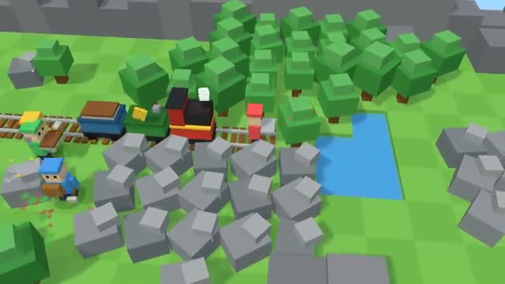

# Rail Rush

The train never stops. Lay the track ahead of it. A multiplayer starter game from [Multiplayer Agent](https://multiplayeragent.com): 3D, co-op, 1–4 players, with bots that fill empty seats.

## How it plays

Chop trees and mine rocks, load them into the crafter wagon and grab the track it makes. Lay it ahead of the train to reach the next station, and bring water before the engine boils over. Every station, the train gets faster.

**Controls:** WASD to walk, hold Space to chop, mine, load, lay and pour. On a phone: drag to walk, hold USE.

## Make it yours in the Game Builder

Open the [Game Builder](https://multiplayeragent.com), choose **Start from a starter game** and pick Rail Rush. It opens as version 1 in your studio, ready to play and publish. Then ask for changes, for example:

- Add a bridge piece that crosses water but costs double
- Make it a snowy map where the engine freezes instead of overheating
- Add a dynamite wagon that clears rocks in one go

## Run it yourself

1. Get a free publishable key (`pk_…`) at [multiplayeragent.com](https://multiplayeragent.com).
2. In `index.html`, put it in place of `pk_REPLACE_ME` in the `MP_CONNECT` block.
3. Serve the folder (for example `npx serve`) and open it. The 3D engine loads as a module, which browsers block from a file on disk.

Without a key it still runs, offline with bots.

## How it is built

- One `index.html` plus three.js in `libs/`. The comment at the top of the script maps the code and explains the multiplayer.
- **Host-run rules:** The host's browser runs the train, the land, the crafter and the heat; if it leaves, the next player takes over.
- **Leaderboard:** How many tiles your train travels before it stops.
- **Bots:** A lumberjack, a miner and a builder bot help until enough people join.
- **Live sync:** Everyone sees the same train, the same land and every tree as it falls.
- `?attract` runs it offline with bots only. The preview video is recorded from it.

## License

MIT.
